# Vibe Launcher

A home screen for Android TV and Google TV. It puts what you were watching behind your apps, and it can switch
off the junk your TV shipped with, from the TV itself. You don't need a computer for that.\*

It's free and open source. There are no ads in it and no account to make.

\* Some TVs want a one-time pairing code typed on a phone before they allow debugging. That happens in the
phone's browser. There is no phone app.

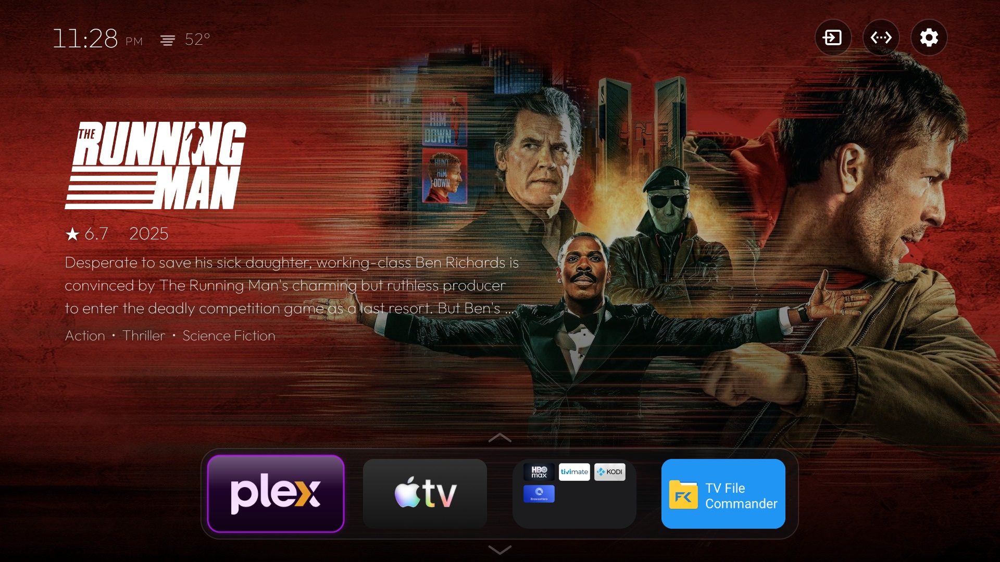

## What it does

| | |
|---|---|
| **1. Debloat the TV from the launcher.** It connects to the TV's own ADB and switches off the apps your TV shipped with, using the [Clean Your TV](https://github.com/Gathin23/cleanyourtv) community's tested list for your model. No computer involved. [More](#cleaning-up-your-tv) | 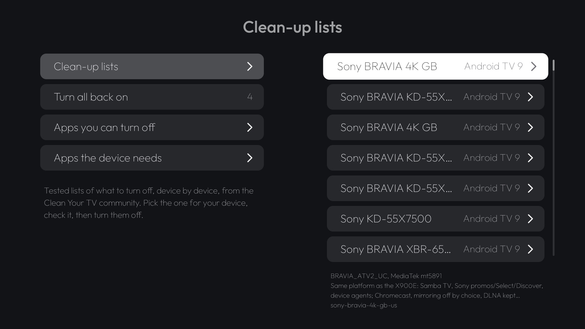 |
| **2. Block ads with the DNS you choose.** It sets the TV's Private DNS for every app at once. AdGuard and Mullvad are built in, or give it a hostname of your own. [More](#cleaning-up-your-tv) |  |
| **3. Backdrops from what you were watching.** The film or show from each app fills the screen behind it, with the title's logo and a description under it. [More](#what-your-apps-are-showing) |  |
| **4. Flights overhead.** A live map of the aircraft near you as a backdrop. A card says which flight each one is and where it's going. [More](#flights-overhead) | 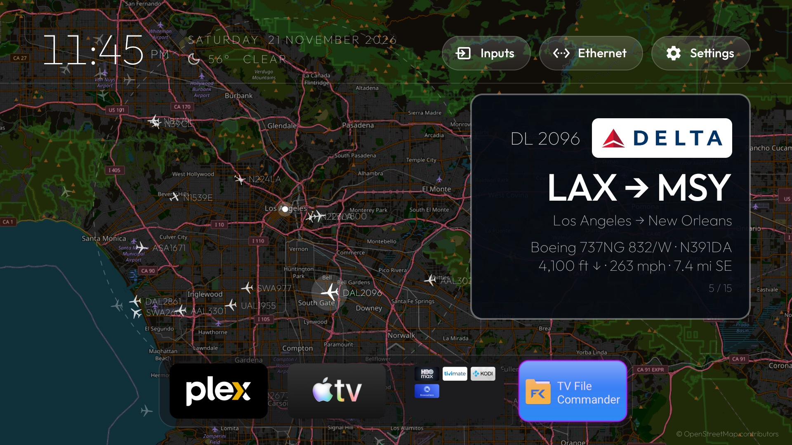 |
| **5. Your own photos and videos as backdrops.** Send them from your phone, or pick them on the TV from free sources. Apple's aerial videos are among them. [More](#your-own-pictures-and-videos) | 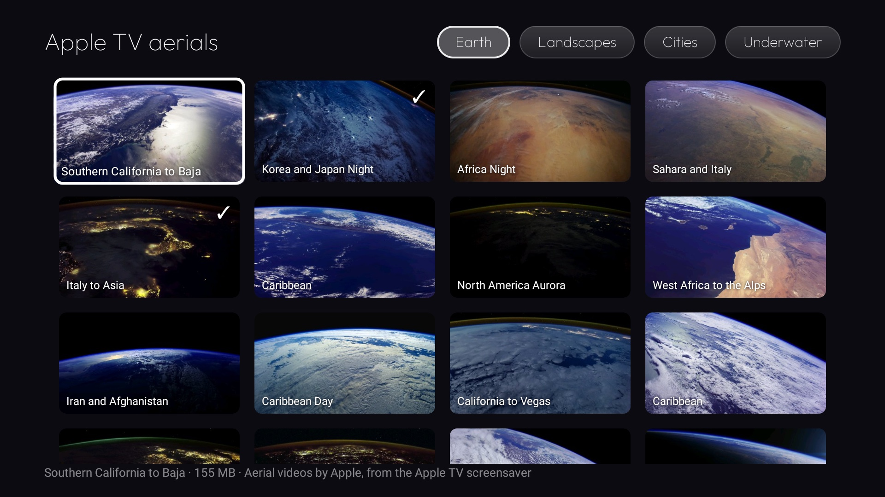 |
| **6. A backdrop order for every app.** Each app and folder has its own ordered list of what shows behind it, so there is always a fallback. [More](#each-app-decides-for-itself) | 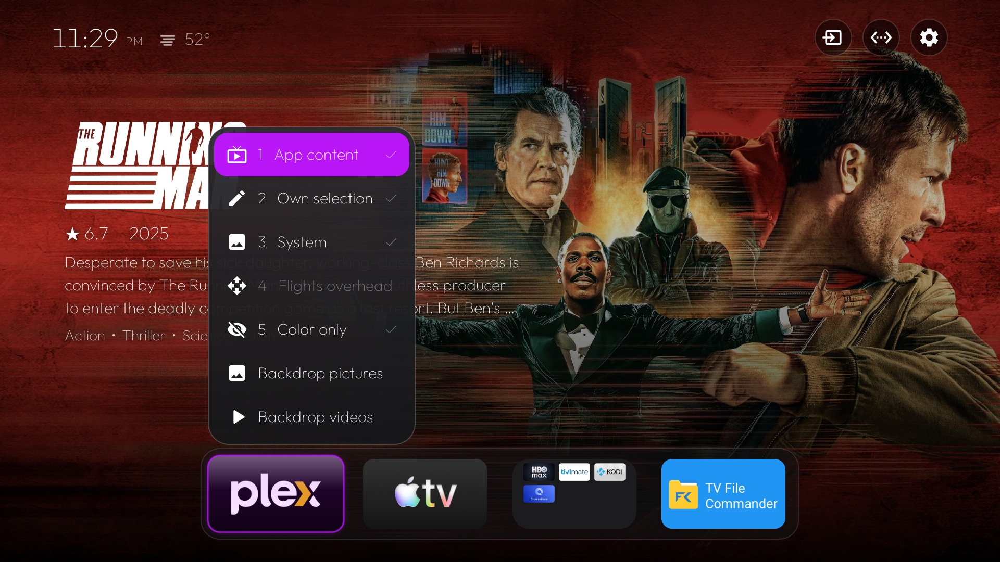 |
| **7. Folders with a dial.** A folder in the dock opens into a dial above it. The backdrop follows whichever app you turn to. [More](#home) |  |
| **8. A slideshow when you walk away.** After a minute, Home cycles through your backdrops. Android's own screensaver can be switched off from the same settings page. [More](#when-you-leave-it-alone) |  |
| **9. Inputs by name.** The inputs menu lists your HDMI ports with whatever is plugged into each, even behind a switch. [More](#home) |  |
| **10. Custom icons and names.** Any app or folder can have its own picture and name. The fonts and the highlight color are yours to choose too. [More](#looks) | 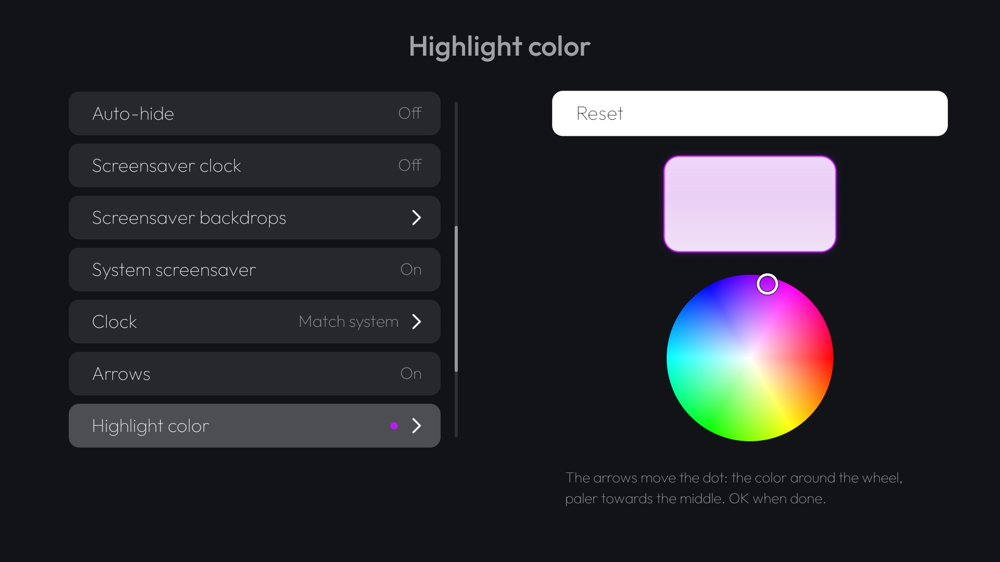 |

It can back up your whole setup and restore it on another TV. It also updates itself and comes in 50 languages.

## Install

1. On the TV, install **Downloader** (by AFTVnews) from the Play Store.
2. Open it and type **5573341**. That code always points at the latest release.
3. Install the APK when it asks. Android will want you to allow Downloader to install apps, once.
4. Open Vibe Launcher and allow its two permissions. It takes you to its Default launcher setting. Choose
   Vibe Launcher there and it walks you through turning on the TV's ADB, which is what makes it your home
   screen.

After that it keeps itself up to date.

Keep a phone nearby, or anything else that can scan a QR code. Whenever there's something long to type or a
file to send, the TV shows a code and you finish on the phone. That's how API keys get typed and how pictures
get sent. The remote does everything else.

Rather have the file? Here it is:
[vibe-launcher.apk](https://github.com/maydings/vibe-launcher/releases/latest/download/vibe-launcher.apk).
It needs Android 8.0 or newer and is under 3 MB.

## Home

Your main apps sit in a dock along the bottom. The app you're on fills the screen behind it with something it
has for you, usually the film or show you were in the middle of, with the title's logo. Press Down for the
rest of your apps.

Press Up and the apps slide away, leaving the picture and a Play button. Left and Right step through what
that app has. Hold OK to open that exact film or episode.

|  | 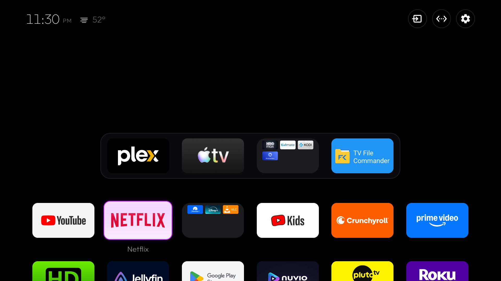 |
|---|---|

Apps can go in folders. A folder in the dock gets a small dial above it. Turn it with Left and Right and the
picture behind follows whichever app is in the middle.

|  |  |
|---|---|

The top bar stays out of the way: the time and the weather on one side, three round buttons on the other.
The first button lists your HDMI ports with whatever is plugged into each, by name, even behind a switch.
There's a fuller bar with the date and labelled menus if you'd rather have that.

|  | 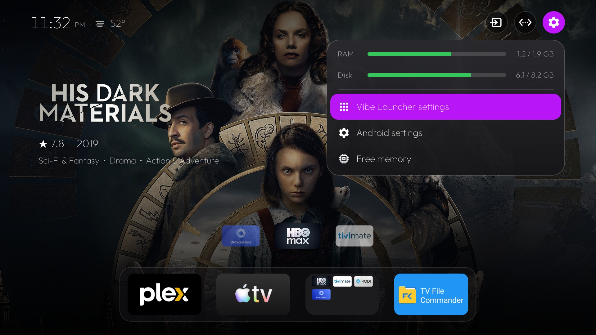 |
|---|---|

## Backdrops

The picture behind your apps is the part most worth setting up. It can come from five places, and each app
chooses between them.

### What your apps are showing

Out of the box, Vibe Launcher reads the cards your apps publish to the TV. Netflix, Prime Video, Apple TV and
Jellyfin all do, along with many others. For each title it looks up clean artwork, without the stickers and
text that apps bake into their own.

You decide where it looks and in what order: Nuvio, Stremio, TMDB, or the app's own picture. A few apps are
handled specially. Plex shows art from your own server. YouTube works through SmartTube. An HDHomeRun tuner
shows what's on right now.

### Film and show details

With a free TMDB key, turn on Settings → Backdrops → Film and show details. The title's logo moves to the left
and its rating, year, synopsis and genres appear under it, the way a streaming app's own screen lays them out.
Titles from your Plex server are matched by the id Plex already has for them, so an oddly spelled name still
finds the right film.

### Your own pictures and videos

Everything of yours lives in Settings → Library. Send files from your phone, or browse on the TV from any of
these:

| Source | What it has |
|---|---|
| Wallhaven | Wallpapers |
| Pexels | Photos and videos |
| Pixabay | Photos and videos |
| NASA | Pictures and videos from its image library |
| Wikimedia Commons | Photos and videos |
| Apple | The aerial screensaver videos from Apple TV |

Each item is kept once and can be used behind any app. A picture can also become an app's tile.

|  | 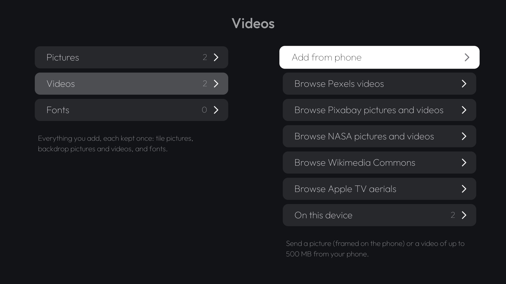 |
|---|---|

### Each app decides for itself

Long-press a tile and choose Edit → Backdrops. You get an ordered list:

1. **App content**: the app's own films and shows, as above.
2. **Own selection**: whatever you ticked in the Library for this app.
3. **System**: the backdrop you set for everything (see below).
4. **Flights overhead**: the map of aircraft near you.
5. **Color only**: the app's own color, as a soft glow.

The launcher uses the first entry that's switched on and has something to show. Everything under it is a
fallback. Reorder the list or switch entries off as you like. Color is the exception: it stays on, because
something has to be there. Folders have the same list.

**System backdrop**, under Settings → Backdrops, is the one shared by every app that has nothing of its own. It
can be pictures and videos you tick in the Library, or the flights. It stays empty until you choose.

|  | 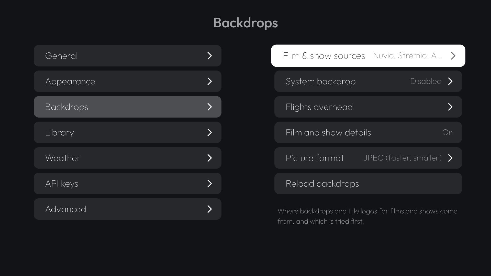 |
|---|---|

### Flights overhead

Turn this on and the backdrop becomes a dark map of your area with the aircraft near you moving across it. A
card at the side goes through them one at a time. It starts with the airline's logo and the flight number.
Then comes the route, with both cities, and the type of aircraft. The last line gives its altitude and speed
and how far it is from you.

No account is needed. Positions refresh every four minutes that way. Add a free OpenSky Network API client
under Settings → API keys and they refresh every thirty seconds. Aircraft are only asked for while the map or
a card is on screen.

If you want the cards without the map, **Show flight cards** puts them over an app's plain color backdrop.

|  | 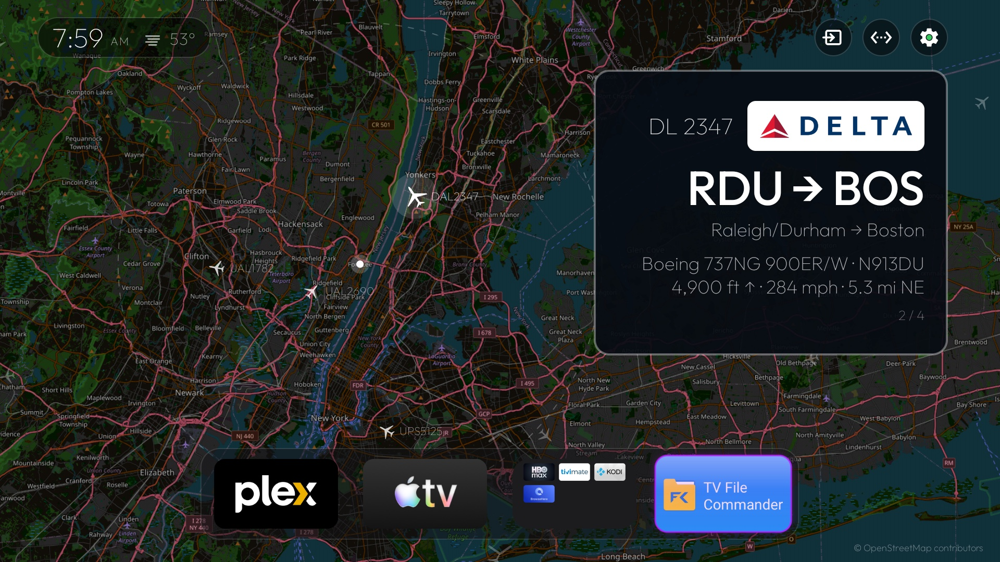 |
|---|---|

### When you leave it alone

After a minute with no key pressed, Home turns into a slideshow. To begin with it runs through the backdrops
of every app in the dock. Under Settings → Appearance → Screensaver backdrops you can narrow it to the app or
folder you were on, or give it a list of its own from the Library. A clock over it is optional.

Android's own screensaver is a different thing, the one that comes up in any app. Settings → Appearance →
System screensaver switches that one off or on.

## Looks

Pick one font for the launcher's text and another for the clock and weather. Outfit is what it comes with.
You can switch to the TV's own font or to any of Google's 2,000 or so, which you browse on the TV with the
ones that have your language's letters listed first. A .ttf or .otf sent from your phone works too. When a
font is missing letters your language needs, the TV's own font is used instead, so you never get two fonts in
one word.

The highlight around whatever is focused can be any color. There's a color wheel with a live preview. Two
sliders set how much of your picture shows through the dock and the top bar.

Any tile can be given a different picture or name. Long-press it and choose Edit.

|  |  |
|---|---|

## Cleaning up your TV

Most TVs come with apps nobody asked for. They sit in the background slowing the TV down, and they crowd the
home screen. Vibe Launcher can switch them off from the TV, the same way a computer with ADB would.

Open **Settings → Advanced**. It tells you what to switch on, one step at a time, until it's connected to the
TV's own ADB. On TVs that only offer Wireless debugging, that includes the one-time pairing from your phone.
Debugging is switched back off when you leave Settings, unless you tell it not to.

From there you have:

- **Clean-up lists**: tested lists from the [Clean Your TV](https://github.com/Gathin23/cleanyourtv)
  community, with your TV's brand and model at the top. Pick one and untick anything you want to keep. The
  rest gets switched off.
- **Apps you can turn off**: every app on the TV, one press each.
- **Turn all back on**: undoes everything Vibe Launcher switched off, and nothing else.
- **Ad blocking**: blocks ad and tracking servers for every app on the TV, using the TV's own Private DNS with
  a filtering service. AdGuard, AdGuard Family and Mullvad are built in, or add your own. Ads that are part of
  the video itself, as on YouTube and Prime Video, still show. Needs Android 9 or newer.
- **Default launcher**: makes Vibe Launcher the real Home, or puts the stock launcher back.
- **Home button (accessibility)**: for devices that won't let ADB be turned on at all. An accessibility
  service makes the remote's Home button open Vibe Launcher. Use ADB when you can.

The parts a TV can't run without are protected and can't be switched off here: Android itself, the Play
Store, the remote, Wi-Fi and the inputs. An app you switch off is still installed, and one press brings it
back.

|  | 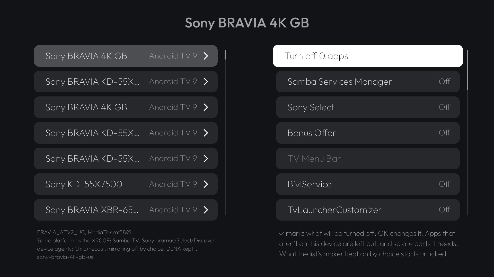 |
|---|---|

## The rest

**Weather** sits under the clock. It works out your city by itself, or you can pick one.

**Backup and restore** saves your whole setup to your phone or to the TV: your layout and pictures along with
your settings and keys, encrypted with a passphrase you choose. Use it to move to another TV. What you switched off stays with each TV.

**Updates** arrive on their own. The launcher shows what changed and installs after one confirmation.

**50 languages**, following your TV or chosen by hand.

| 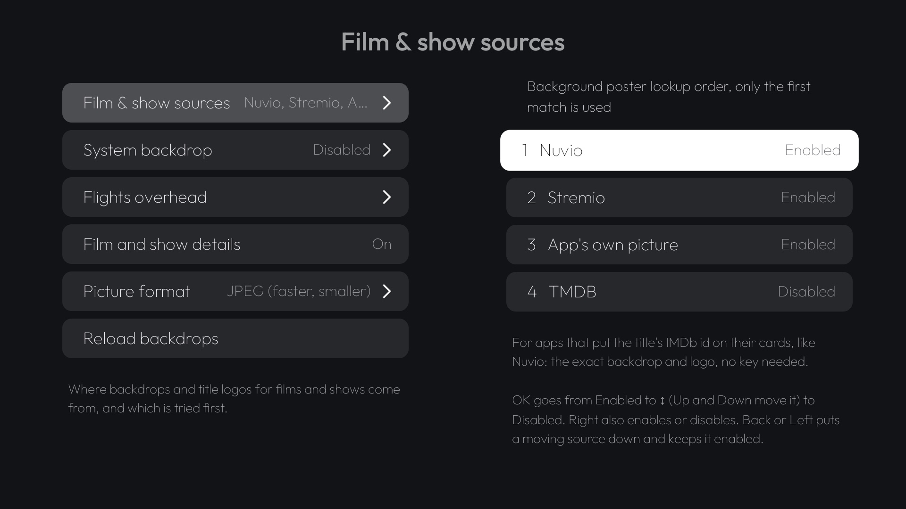 |  |
|---|---|

## Privacy

Nothing is collected and nothing is sent to me. The launcher goes online only for the things you'd expect:
artwork, the weather, the flights if you turn them on, the wallpapers you browse, the clean-up lists and its
own updates. Your keys stay on the TV. The details are in the [privacy policy](vibe-launcher/docs/PRIVACY.md).

## Tested on

| Device | Android |
|---|---|
| Sony Bravia XBR-940E | 9 |
| Sony Bravia 900F | 9 |
| NVIDIA Shield TV (2017) | 11 |
| onn 4K Streaming Device (Google TV) | 14 |

It should work on any Android TV or Google TV with Android 8.0 or newer.

## Building it

The source, how to build it, how the backdrops work and how to run the tests are in
[`vibe-launcher/`](vibe-launcher/README.md). The only script in this repo builds the app and installs it on a
TV for development. There are no debloat scripts, because all of that lives in the app. Corrections to the
machine-made translations are welcome.

## Licence

MIT, see [`LICENSE`](LICENSE). The Outfit typeface is under the SIL Open Font License (`vibe-launcher/FONT-LICENSE-OFL.txt`). The weather
icons are from [Feather](https://feathericons.com) (MIT). Wireless debugging's SPAKE2 (`Spake2.java`) is a
Java port of BoringSSL's `spake25519.cc` (Copyright 2016 The BoringSSL Authors, Apache License 2.0:
`vibe-launcher/LICENSE-APACHE-2.0.txt`). Backdrops use the TMDB API but aren't endorsed or certified by
TMDB. Weather by [Open-Meteo](https://open-meteo.com). Aircraft positions by [The OpenSky Network](https://opensky-network.org);
aircraft and route details by [adsbdb](https://www.adsbdb.com), routes it lacks from [Virtual Radar Server's standing data](https://github.com/vradarserver/standing-data). Map © [OpenStreetMap](https://www.openstreetmap.org/copyright) contributors. Airline logos belong to their airlines; they're fetched from
Aviasales and from [Jxck-S/airline-logos](https://github.com/Jxck-S/airline-logos) to say whose aircraft it is.
