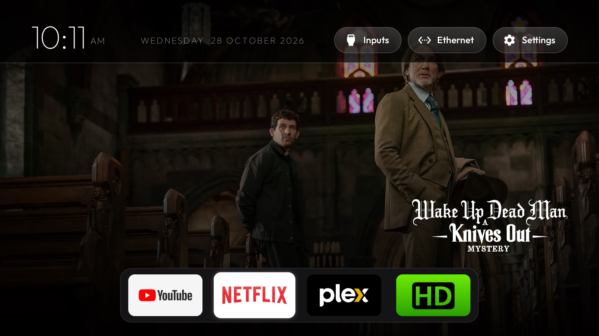
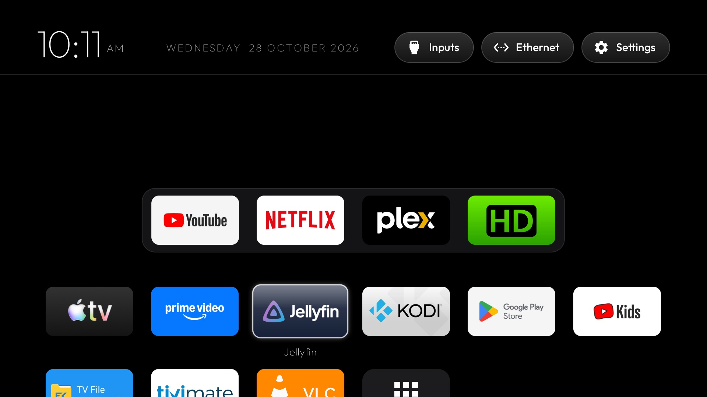
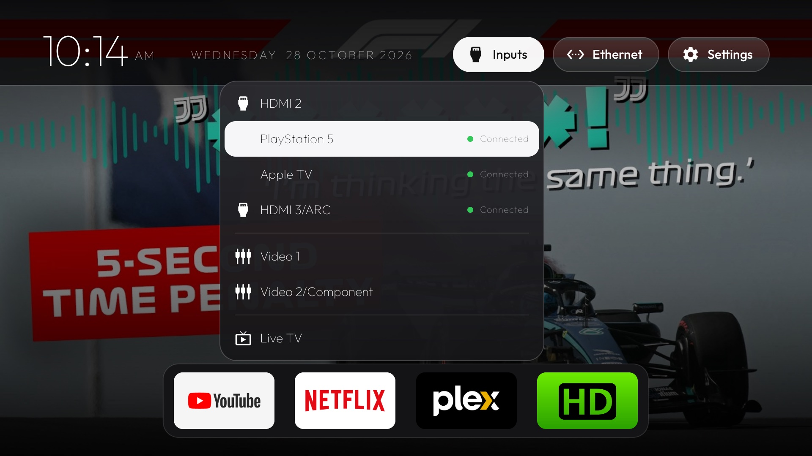
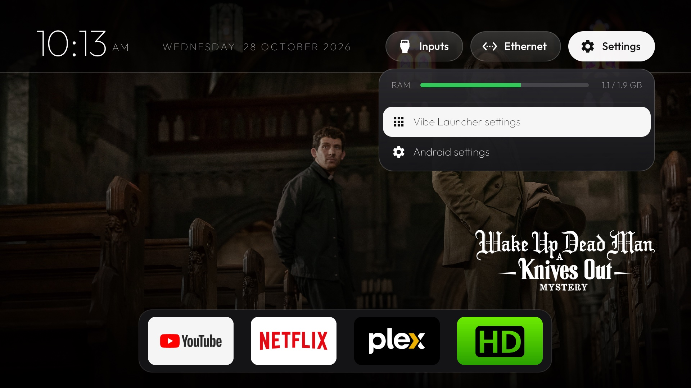
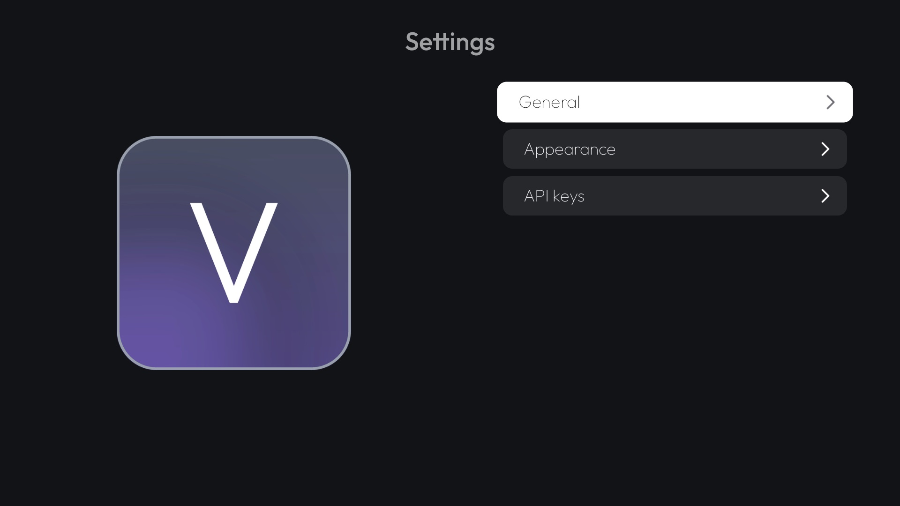
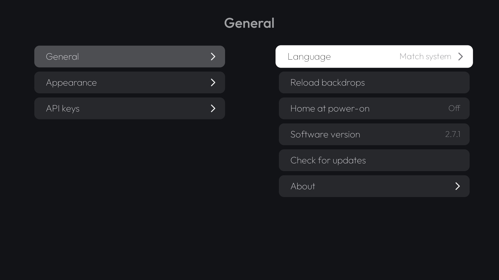
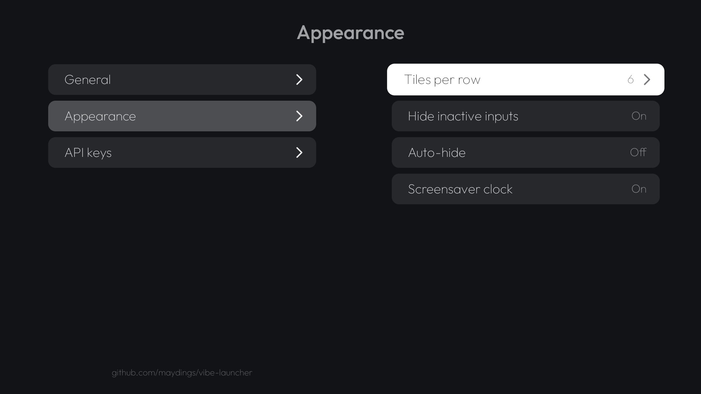
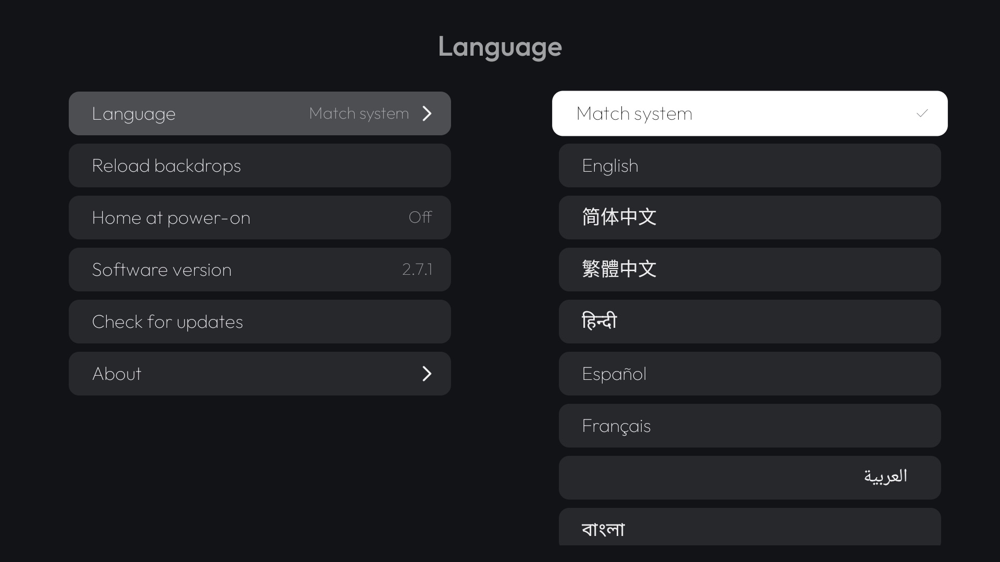
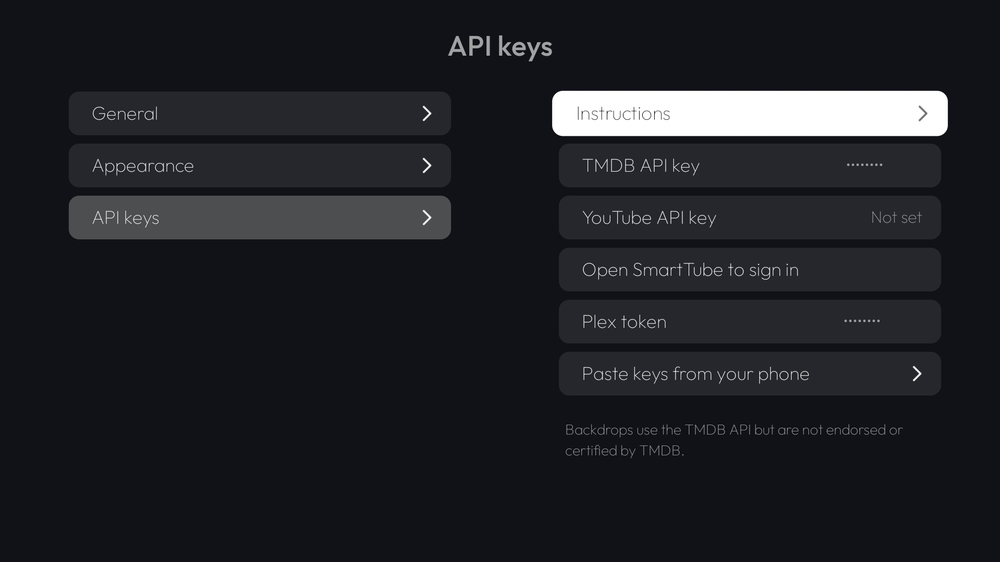
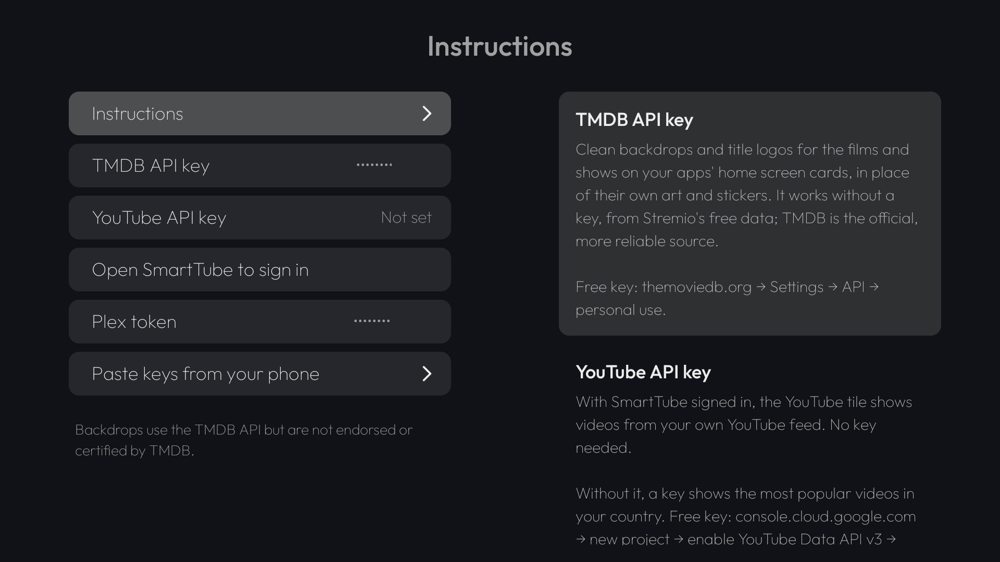

# Vibe Launcher

**A clean, snappy home screen for Android TV.** Your favourite apps in a dock, full-screen artwork from
what they're offering you, and nothing else: **no ads, no data collection**, no sponsored rows, no
accounts. Free and open source.

I built Vibe Launcher for my own TVs at home, because I wanted a home screen that just shows my apps
and gets out of the way. It works well enough for us that I'd like to share it with everyone else.



**[Download the latest APK](https://github.com/maydings/vibe-launcher/releases/latest/download/vibe-launcher.apk)**
· Android TV and Google TV, Android 8.0 or newer · about 1.2 MB

## Highlights

- **Backdrops from your apps.** The focused app fills the screen with what it's actually showing you:
  the film or show on its home screen card, with the title's own logo.
- **Dock and grid.** One to six favourite apps in a dock; press Down for everything else.
- **Inputs at a glance.** HDMI ports with what's connected, devices behind a switch listed by name.
- **A slideshow when idle.** Leave Home alone for a minute and every app's backdrops play full screen.
- **50 languages.** Follows your TV, or pick one.
- **Settings that slide.** Full screen and ready the moment you open it: pages slide in from the side,
  changes apply as you make them, and each key comes with instructions.
- **Home at power-on.** For TVs that wake up on their last input: Home comes up instead (optional).
- **Your Home button, no computer needed.** On TVs that keep their own launcher, an optional service
  sends the Home button to Vibe Launcher.
- **Updates itself.** Shows what's new, checks the download, installs with one confirmation.
- **Snappy and light.** Moving around feels instant, even on older TVs with 1 to 2 GB of RAM. No
  background services (but the optional Home button service), and it lets go of its
  pictures while you're in another app.

## The home screen

Your favourite apps sit in a dock at the bottom of the screen: four, five or six, to suit the size of
your TV, or as few as one, as you choose. Only the dock shows, with a faint arrow under it; press Down and
the rest of your apps slide up in a grid. A single glass highlight springs from tile to tile.



### Backdrops

As you move along the dock, the screen behind it fills with artwork from the focused app:

- **The apps' own home screen cards** (Netflix, Apple TV, Prime Video, Jellyfin and others): the film
  or show each one is offering, shown as a clean full-size backdrop with the title's logo instead of
  the app's own art and stickers. Works out of the box, using Stremio's free film data.
- **TMDB** for the most reliable artwork, with a free API key.
- **YouTube**: your own feed through [SmartTube](https://github.com/yuliskov/SmartTube), which
  Settings can install for you; or the most popular videos in your country with a YouTube API key;
  or, with neither, trailers of the films everyone's watching.
- **Plex**: Continue Watching and recently added from your own server, with your Plex token.
- **HDHomeRun**: what's on your tuner right now, from SiliconDust's free guide. No setup.

Low-resolution art becomes a 2×2 wall instead of one blurry still, or, when an app has only a small
picture or two (VLC's frames of what you're watching), that picture on its own. Apps with nothing to
show get a soft glow in their own colour.

**Just the picture**: press Up on the dock and the apps slide away, leaving the backdrop on its own,
and a **Play** button slides in from the left, just above where the apps were. It opens on what you've started watching
(the last one first), with the time left under the button, such as "2 hours, 5 minutes remaining";
Left and Right then go through everything else of that app's; hold Left or Right to move on to the
next app in the dock, going round from the last to the first. Hold OK (or press and hold Play) and the
button fills up, then opens the film, show or video in that app, or the app itself when there's no
single title. Faint arrows at the screen's edges show where the remote goes. What you're watching comes
from the apps themselves: those that share their "Continue watching" with Android TV (Jellyfin does,
for example) get it, and Plex gets it from your own server (with a Plex token); the others just the
Play button. An app with no picture yet goes straight to the top bar instead.


### Slideshow

Leave Home alone for a minute and the apps and the top bar slide away: the backdrops of every app in
the dock follow each other at random, ten seconds each, with only the clock over them, where it sits on
the top bar (Settings → Appearance → Screensaver clock turns it off). Press any button and
Home comes back, on the app of the picture showing, with its picture behind the dock. It
doesn't start while a menu or Settings is open, and it keeps the screen on only as long as your TV's
own screen-off setting would. (This replaces the screensaver of earlier versions; pick another, or
Turn screen off, in your TV's screen saver settings.)

## The top bar

A frosted bar with the clock and date, and three menus. Left and Right move between them. With
**Auto-hide** on it stays out of sight on the dock, so the picture fills the screen: it
slides in when you press Up from the picture alone, or move down into the app grid.

- **Inputs** lists every HDMI and AV input, with whether something is connected to each HDMI one, plus Live TV. Devices
  that announce themselves over HDMI-CEC appear by name under their port, so an Apple TV and a
  PlayStation behind an HDMI switch each get their own row. Names and hidden inputs from the TV's own
  settings carry over.
- **Network** shows each connection with its IP address (and the Wi-Fi link speed), and VPNs.
- **Settings** shows live memory use and opens Vibe Launcher's settings or Android's.

|  |  |
|---|---|

## Settings

Full screen: the logo on the left and **General**, **Appearance** and
**API keys** on the right. Picking one slides its list over the logo and its page in on the right;
Back or Left slides back. Changes apply as you make them: a new number of tiles per row rebuilds Home
behind Settings, ready when you leave, and a new language rebuilds both (Settings comes back on General
after a moment). The focused row's explanation shows under the list. Settings is built when Home
starts, so opening it is just a fade.

|  |  |
|---|---|

**General**: language, reloading the backdrops, Home at power-on, the Home button, Restart… (with the Home button service), the
software version with its update check, and **About**: who made it, the project's page (with a QR code to
open it on a phone), where to report a problem, the license and the credits.

- **Language**: Match system (the default), or any of 50 languages, each listed in its own name. The
  clock and date follow it.
- **Reload backdrops**: empties the saved pictures and downloads them all again, each
  app's first one first.
- **Home at power-on**: Off (the default) or On. For TVs that wake up on the input or app they were
  left on (Sony goes back to the last HDMI input): On brings Home up just after the screen turns on. With
  the Home button service on, a button pressed in that first moment keeps you where the TV woke up.
- **Home button**: Off or On, at any time (shown unless Vibe Launcher is already your TV's Home). On
  explains the Home button service first, then opens Settings → Accessibility to turn it on; Off turns
  it off straight away.
- **Restart…** (with the Home button service on): opens the TV's own power menu, which asks before it
  restarts. An app can't restart the TV itself; only the service can ask the TV, so without it this
  doesn't show.

**Appearance**: tiles per row, apps in dock, hiding inactive inputs, auto-hide, the screensaver
clock, the arrows and the highlight color.

- **Tiles per row**: 4, 5 or 6. Tiles shrink to fit, and a full dock holds as many apps. Until you pick,
  it follows the TV's size: 4 under 51", 5 up to 74", 6 from 74" up. A streaming box can't tell
  the size of the TV it's plugged into, so it starts at 4.
- **Apps in dock**: from 1 up to a full row (the default). A shorter dock keeps the tiles' size and
  sits centred, its band fitted round it, without the app's big name over it; the rows below stay full.
- **Hide inactive inputs**: the Inputs menu leaves out HDMI inputs with nothing connected. AV inputs
  always stay: TVs can't tell whether anything is plugged into them.
- **Auto-hide**: On keeps the top bar out of sight on the dock and with the picture alone;
  Off (the default) keeps it always on screen, and Up from the dock then waits a moment, so scrolling up quickly
  passes the picture alone and reaches the bar.
- **Screensaver clock**: On (the default) shows the time on the slideshow, in the same place as on the
  top bar but without the bar; Off leaves the pictures alone.
- **Arrows**: On (the default) shows the faint arrows that point where the remote goes: above and below
  the dock (to the picture alone, and to the rest of your apps), under the top bar, and at the screen's
  edges with the picture alone. Off hides them all.
- **Highlight color**: the color of what's focused, white by default: the glass, the top bar's buttons,
  the menus' rows, the Play button's fill and Settings' rows (their text turns dark or white to stay
  readable). Pick one on a color wheel with
  the arrows (paler towards the middle, OK when done), with a preview of the glass on a white tile: a colored
  highlight makes it easier to see which white tile (YouTube, Netflix) is focused. **Reset** puts it back to white.

|  |  |
|---|---|

**API keys**: optional keys that unlock more backdrops: **TMDB**, **YouTube** and **Plex**. Each has
a line under the list on what it adds, and **Instructions**, first on the page, says where to get each,
free. OK on a key edits it in place.
Typing a 32-character key with a remote is no fun, so **Paste keys from your phone** shows a **QR
code**: scan it and paste the keys there. Saved keys stay on the TV and show only their last four
characters. Under YouTube, one row installs SmartTube (its latest release, checked against GitHub's
checksum) or opens it to sign in.

|  |  |
|---|---|

## Updates

Vibe Launcher checks for new versions when the TV is turned on or wakes from sleep, once a day, and
whenever you open the Settings menu, or ask it in Settings → General → **Check for updates**. When one
is out, a green dot appears in the Settings gear and the menu offers **Update to** it. You see what's
new in every version since yours, then **Install**: the download is checked against the release's
SHA-256 before Android asks you to confirm, and Home comes back by itself afterwards.


## Managing apps

Long-press OK (or press the remote's Menu key, if it has one) on any tile to **move** it (into or out of the dock), **hide** it, **uninstall** it or
open **App info**. Hidden apps come back from the same menu.

## Install

Download **[vibe-launcher.apk](https://github.com/maydings/vibe-launcher/releases/latest/download/vibe-launcher.apk)**
and install it. No account needed.

**Home button service.** Many TVs keep sending the Home button to their own launcher, which can only be
turned off with a computer ([adb](vibe-launcher/README.md)). Without that, Vibe Launcher offers its Home
button service instead (turned on in Settings → Accessibility; it walks you through it): Home then opens
Vibe Launcher, and holding Home opens the TV's Settings. With it on, Settings → General also offers
**Restart…**. It's optional, it reads nothing on screen, and where Vibe Launcher is already Home it isn't
offered.

(Up to 2.7.2 there was a separate app store version, vibe-launcher-store.apk, which didn't update itself.
If you have it, install vibe-launcher.apk over it once: they're signed alike, so your settings stay, and
it updates itself from then on.)

### On the TV

1. Install a downloader or file manager from the Play Store, for example **Downloader** (by
   AFTVnews) or **X-plore**.
2. Open the download link above in it and open the APK. Android asks once to allow that app to install
   apps; allow it.
3. Open Vibe Launcher from your apps and allow its two permissions: TV listings (for the apps'
   cards) and location (Android only reveals the Wi-Fi network's name with it).
4. Make it your home screen when it offers to, or later from the Settings menu → **Make Vibe Launcher
   your Home**: Android's own choice where the TV has one that works, otherwise the Home button service.

### Keeping it as your home screen

Google's own launcher and Google's setup app are system apps that can keep answering the Home button,
even with Vibe Launcher set as the default. Without a computer, the Home button service (above) takes
care of that. With one, you can turn them off instead, once, with
[adb](https://developer.android.com/tools/adb):

```bash
adb connect <tv-ip>:5555
adb install -g vibe-launcher.apk
adb shell am start -n com.maydings.vibelauncher/.MainActivity
# Google's launcher (on Google TV: com.google.android.apps.tv.launcherx) and setup app
adb shell pm disable-user --user 0 com.google.android.tvlauncher
adb shell pm disable-user --user 0 com.google.android.tungsten.setupwraith
# Last: Android forgets the chosen Home whenever one is turned on or off
adb shell cmd package set-home-activity com.maydings.vibelauncher/.MainActivity
```

Two things to check before turning off the setup app:

- **Wi-Fi**: a network saved during the TV's first-time setup belongs to the setup app and goes with
  it. If `adb shell dumpsys wifi | grep -o 'cname=[^ ]*'` names setupwraith, forget the network and
  join it again in Settings first (or use Ethernet).
- **Casting**: on some Google TVs, casting from a phone needs the setup app. If you cast, leave it on.

To undo either, `adb shell pm enable --user 0 <package>`.

**Removing the TV's ads and bloat** is a separate job, and this project only replaces the home
screen. For that, see [Gathin23/tv-vibehack](https://github.com/Gathin23/tv-vibehack), with tested
lists for over a hundred TV models.

## Tested on

| Device | Android | Set up with |
|---|---|---|
| Sony Bravia XBR-940E | 9 | adb |
| Sony Bravia 900F | 9 | adb |
| NVIDIA Shield TV (2017) | 11 | adb |
| onn 4K Streaming Device (Walmart, Google TV) | 14 | adb and Home button service |

It should run on any Android TV or Google TV with Android 8.0 or newer.

## Privacy

**No data collection and no ads, ever.** No accounts, no analytics, no tracking, and nothing is ever
sent to me. Vibe Launcher goes online only to fetch artwork (looking up the titles on your apps' cards
with TMDB or Stremio, and asking YouTube, your own Plex server or your HDHomeRun's guide) and to check
this project's releases for updates (the Google Play version leaves updates to Play). Your API keys
stay on the TV. The details are in the [privacy policy](vibe-launcher/docs/PRIVACY.md).

## Build it yourself

The source, a build script and how the backdrops work are in
[`vibe-launcher/`](vibe-launcher/README.md). Contributions are welcome, including corrections to the
machine-made translations (`vibe-launcher/app/src/main/res/values-*/strings.xml`).

## Licence

MIT, see [`LICENSE`](LICENSE). Started as a fork of
[Gathin23/tv-vibehack](https://github.com/Gathin23/tv-vibehack). The Outfit typeface is under the SIL
Open Font License (`vibe-launcher/FONT-LICENSE-OFL.txt`). Backdrops use the TMDB API but are not
endorsed or certified by TMDB.
