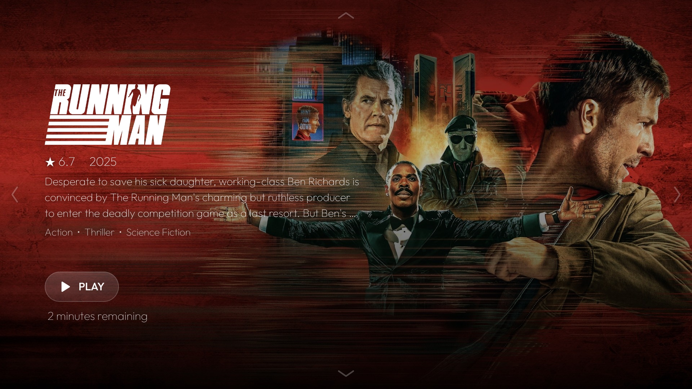
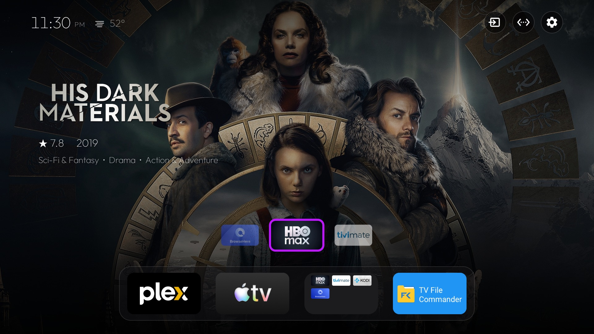
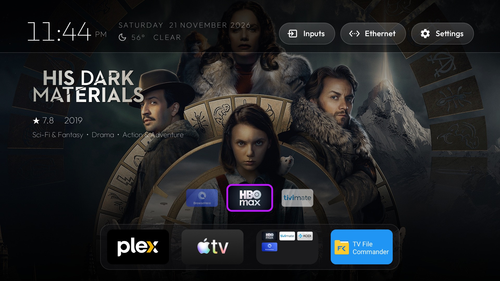
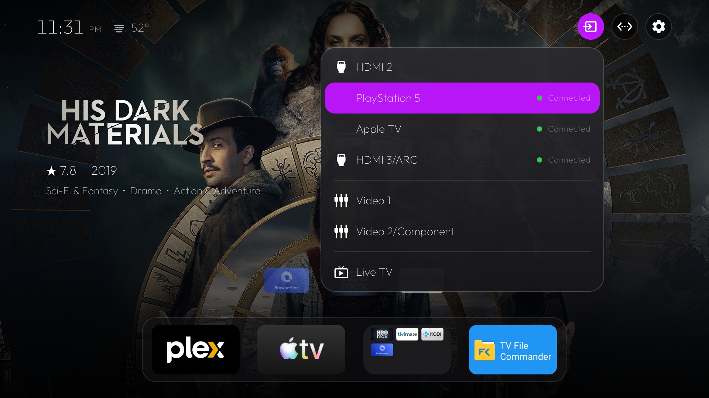
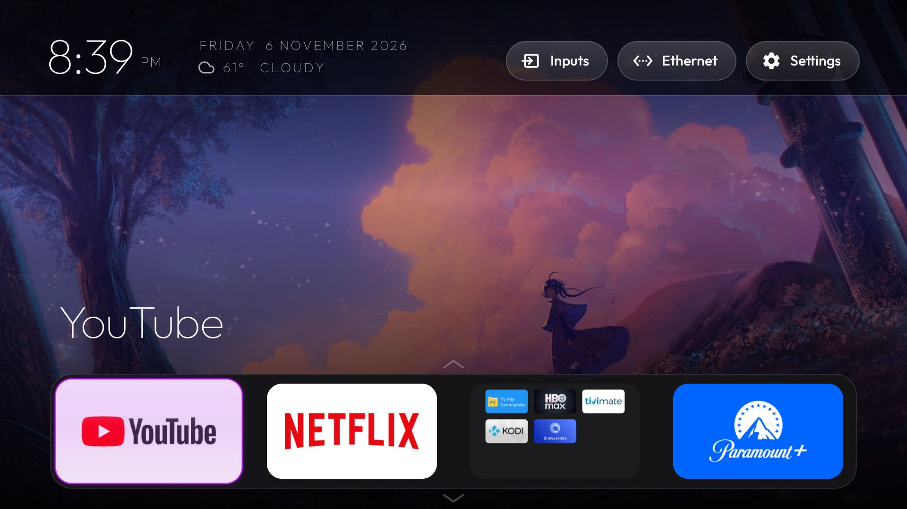
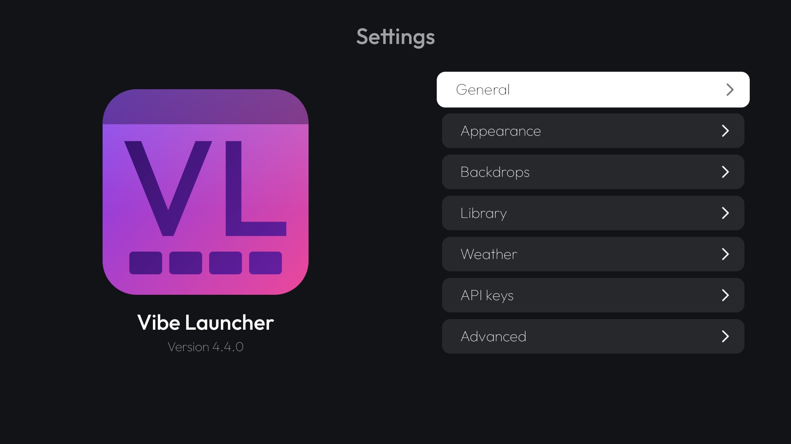
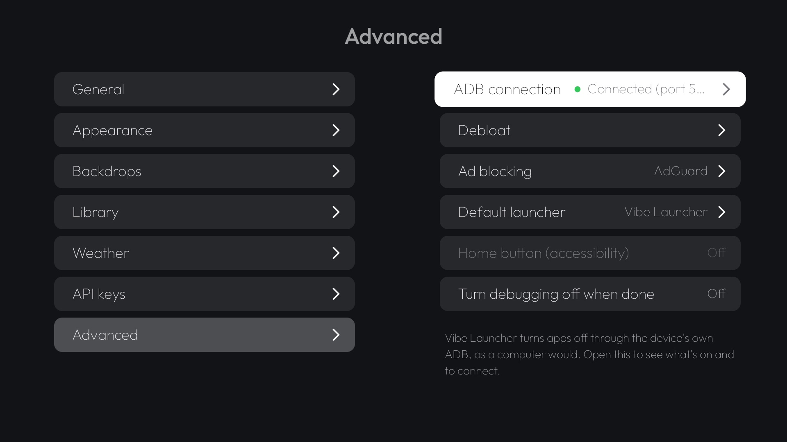

# Vibe Launcher

A customizable home screen for Android/Google TV with built-in ADB debugging to debloat your TV without the
need for any other device\* or AI.

\* A phone may be required to enter a one-time pairing code to enable adb on some devices. No phone app needed.

No ads, no accounts, no tracking. Free and open source.

## Get it on your TV

1. On the TV, install **Downloader** (by AFTVnews) from the Play Store.
2. Open Downloader and type **5573341**. That code always points to the latest release.
3. Install the APK when it asks. Android wants you to allow Downloader to install apps once; say yes.
4. Open Vibe Launcher and allow its two permissions. It then opens its Default launcher setting: pick Vibe
   Launcher and it walks you through switching on the TV's ADB, which makes it your home screen.

That's it. From then on it updates itself.

**You'll also want a phone** (or a tablet, anything with a camera that can scan a QR code) for a few
things: typing API keys, sending pictures and wallpapers, backing up to the phone, and pairing Wireless
debugging. The TV shows a QR code and you finish on the phone. Everything else works with just the remote.

(If you'd rather, the APK is here:
[vibe-launcher.apk](https://github.com/maydings/vibe-launcher/releases/latest/download/vibe-launcher.apk).
Android 8.0 or newer, about 2 MB.)

## The home screen

Your favourite apps sit in a dock at the bottom. Whatever app you're on fills the screen with what it's
offering you: the film or show from its own home screen card, with the title's logo. Press Down for the
rest of your apps.

Press Up and the apps slide away, leaving just the picture and a Play button. Left and Right go through
everything that app has. Hold OK and it opens that exact film or episode.

|  |  |
|---|---|

Group apps into folders. A folder in the dock turns into a small dial above it: Left and Right spin it,
and the background follows whichever app is in the middle.

|  |  |
|---|---|

The top bar is minimal: a small clock and the weather on the left, three round buttons on the right
(your inputs, the network and settings), nothing else over your picture. Want more? Switch to the full
bar, with the date and the menus spelled out.

The Inputs menu lists your HDMI ports and what's plugged into each, by name, even behind a switch.

|  |  |
|---|---|

### Where the pictures come from

Out of the box it reads the cards your apps already publish (Netflix, Prime Video, Apple TV, Jellyfin and
others) and finds clean artwork for each title. You choose the order it looks: Nuvio, Stremio, TMDB or the
app's own picture. Plex, YouTube (through SmartTube) and an HDHomeRun tuner each get their own pictures too.

With a TMDB key you can also turn on **Film and show details** (Settings → Backdrops): the title's logo moves to
the left with its TMDB rating, year, synopsis and genres under it. The details are looked up when a title is first shown, whichever source the backdrop came from: by its name, or for a film or show from your Plex server, by the TMDB id the server has for it.

You can also use your own pictures and videos, all added in one place (Settings → Library): sent
from your phone, or picked on the TV from Wallhaven, Pixabay, NASA, Wikimedia Commons, Pexels or Apple TV's
aerial screensaver videos. Each is kept once, under its own name, and can be used anywhere:

- **Each app and folder** has its own ordered list of what shows behind it (tile menu → Edit → Backdrops): App
  content (the app's own pictures), its own selection from the Library, the System backdrop, Flights overhead, and
  its color. The first one that's enabled and has something to show is used; the rest are only fallbacks. Reorder
  them or turn any off (the color always stays on). Flights overhead starts turned off.
- **System backdrop** (Settings → Backdrops) is one more ordered list of two: pictures and videos you tick in the
  Library, and the flights overhead. Neither is on until you choose it, and only the first one with something to
  show is used.
- **Flights overhead** shows the aircraft near you moving over a map of your area, and a board for each in turn:
  airline logo, flight, route, aircraft, altitude, speed and distance. With no aircraft nearby, the map shows on
  its own. The board alone, without the map, can also show over a tile's color (Settings → Backdrops → Flights
  overhead → Show flight cards). Aircraft are only asked for while the map or the board is on screen. It works with no account (updated every 4 minutes), or every 30 seconds with a free OpenSky Network API
  client (Settings → API keys).
- **Any picture** can go on an app or folder tile (tile menu → Edit → Change icon, beside the app’s own banner and icon). Those cropped for a tile
  on your phone are listed first; the bigger ones made for backdrops follow.

Fonts too: pick one for Vibe Launcher's text and another for the clock and weather (Settings → Appearance), from
Outfit, the TV's own, or any of Google's 2,000 fonts (browsed on the TV, those for your language first) or a .ttf or
.otf from your phone. A font without your language's letters isn't used for it: the TV's own font is, so nothing
shows in two fonts at once.

Leave Home alone for a minute and it turns into a slideshow of all of it; or of just the app or folder you were on,
or of a list of its own that you tick in the Library (Settings → Appearance → Screensaver backdrops).

## Cleaning up your TV

Most TVs come with apps you never asked for that run in the background, fill the home screen and slow
everything down. Vibe Launcher can turn them off, from the TV, the same way a computer with ADB would.

Open **Settings → Advanced** and it tells you what to switch on, one step at a time, until it's connected to
the TV's own ADB. On TVs that only have Wireless debugging, that includes the one-time pairing with your
phone. It turns debugging back off when you leave Settings. Then:

- **Clean-up lists**: tested lists from the [Clean Your TV](https://github.com/Gathin23/cleanyourtv)
  community, with your TV's brand and model at the top. Pick one, untick anything you want to keep, and
  turn the rest off.
- **Apps you can turn off**: every app on the TV, on or off with OK.
- **Turn all back on**: undoes everything Vibe Launcher turned off, and nothing else.
- **Ad blocking**: blocks ad and tracking servers for every app on the TV, through the TV's own Private DNS
  and a service that filters them: AdGuard, AdGuard Family, Mullvad or your own. Ads built into the video
  itself, as on YouTube and Prime Video, still show. Android 9 or newer.
- **Default launcher**: makes Vibe Launcher the real Home, or puts the stock launcher back.
- **Home button (accessibility)**: for devices whose software won't let ADB be turned on, an accessibility service makes the remote's Home button open Vibe Launcher. Using ADB is recommended when it's available.

Parts the TV needs (Android itself, the Play Store, the remote, Wi-Fi, the inputs) are protected and
can't be turned off from here. A turned-off app is still installed, and one press brings it back.

|  |  |
|---|---|

## Settings

Everything is in Vibe Launcher's own settings: appearance, the top bar, backdrops and wallpapers, weather,
API keys, and the Advanced tab for the cleanup. Anything long to type, like an API key or a picture,
comes from your phone: scan the QR code on screen and do it there.

|  |  |
|---|---|

Pick the highlight color for whatever's focused on a color wheel, with a preview on a white tile. Set how much of your
picture shows through the dock and the top bar on a slider, with a sample of each as it moves.

|  |  |
|---|---|

Also in there:

- **Backup and restore**: save your setup to your phone and bring it back, or move it to another TV. It
  holds your tiles, folders, custom pictures, settings and keys. What you turned off stays with each TV.
- **Updates**: it checks for new versions, shows what changed, and installs with one confirmation.
- **50 languages**, following your TV or picked by hand.

## Privacy

Nothing is collected and nothing is sent to me. It goes online only for artwork, the weather, the flights overhead (if
you turn them on), the wallpapers you browse, the clean-up lists and its own updates. Your keys stay on the TV. The details are
in the [privacy policy](vibe-launcher/docs/PRIVACY.md).

## Tested on

| Device | Android |
|---|---|
| Sony Bravia XBR-940E | 9 |
| Sony Bravia 900F | 9 |
| NVIDIA Shield TV (2017) | 11 |
| onn 4K Streaming Device (Google TV) | 14 |

It should work on any Android TV or Google TV with Android 8.0 or newer.

## Building it

The source, how to build it and how the backdrops work are in [`vibe-launcher/`](vibe-launcher/README.md).
The only script in this repo builds the app and installs it on a TV for development. There are no
debloat scripts: all of that lives in the app. Corrections to the machine-made translations are welcome.

## Licence

MIT, see [`LICENSE`](LICENSE). The Outfit typeface is under the SIL Open Font License (`vibe-launcher/FONT-LICENSE-OFL.txt`). The weather
icons are from [Feather](https://feathericons.com) (MIT). Wireless debugging's SPAKE2 (`Spake2.java`) is a
Java port of BoringSSL's `spake25519.cc` (Copyright 2016 The BoringSSL Authors, Apache License 2.0:
`vibe-launcher/LICENSE-APACHE-2.0.txt`). Backdrops use the TMDB API but aren't endorsed or certified by
TMDB. Weather by [Open-Meteo](https://open-meteo.com). Aircraft positions by [The OpenSky Network](https://opensky-network.org);
aircraft and route details by [adsbdb](https://www.adsbdb.com), routes it lacks from [Virtual Radar Server's standing data](https://github.com/vradarserver/standing-data). Map © [OpenStreetMap](https://www.openstreetmap.org/copyright) contributors. Airline logos belong to their airlines; they're fetched from
Aviasales and from [Jxck-S/airline-logos](https://github.com/Jxck-S/airline-logos) to say whose aircraft it is.
