# Vibe Launcher

A home screen for Android TV and Google TV, and a way to clean the junk off your TV. Version 4 does both
from the TV itself. You don't need a computer, a cable or a script, just a TV that's online (and a phone\*).

\* Only if your TV has nothing but Wireless debugging (some Google TV devices): it needs a one-time pairing
with a code typed on a phone.

No ads, no accounts, no tracking. Free and open source.

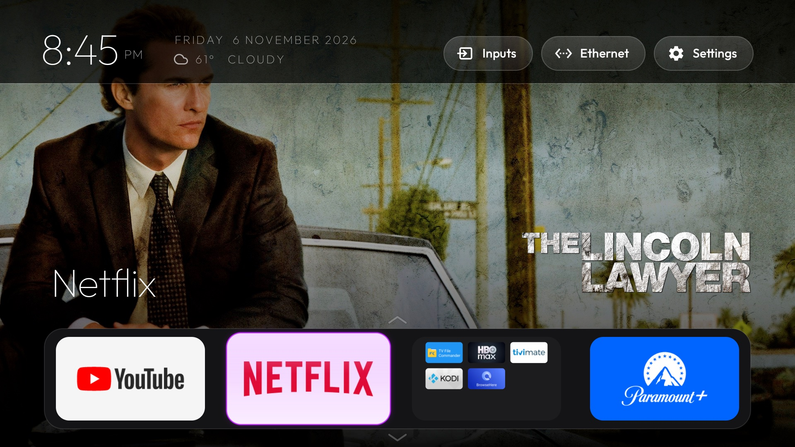

## Get it on your TV

1. On the TV, install **Downloader** (by AFTVnews) from the Play Store.
2. Open Downloader and type **5573341**. That code always points to the latest release.
3. Install the APK when it asks. Android wants you to allow Downloader to install apps once; say yes.
4. Open Vibe Launcher, allow its two permissions, and let it become your home screen when it offers.

That's it. From then on it updates itself.

**You'll also want a phone** (or a tablet, anything with a camera that can scan a QR code) for a few
things: typing API keys, sending pictures and wallpapers, backing up to the phone, and pairing Wireless
debugging. The TV shows a QR code and you finish on the phone. Everything else works with just the remote.

(If you'd rather, the APK is here:
[vibe-launcher.apk](https://github.com/maydings/vibe-launcher/releases/latest/download/vibe-launcher.apk).
Android 8.0 or newer, about 2 MB.)

## The home screen

Your favourite apps sit in a dock at the bottom. Whatever app you're on fills the screen with what it's
offering you: the film or show from its own home screen card, with the title's logo. Press Down for the
rest of your apps.

Press Up and the apps slide away, leaving just the picture and a Play button. Left and Right go through
everything that app has. Hold OK and it opens that exact film or episode.

| 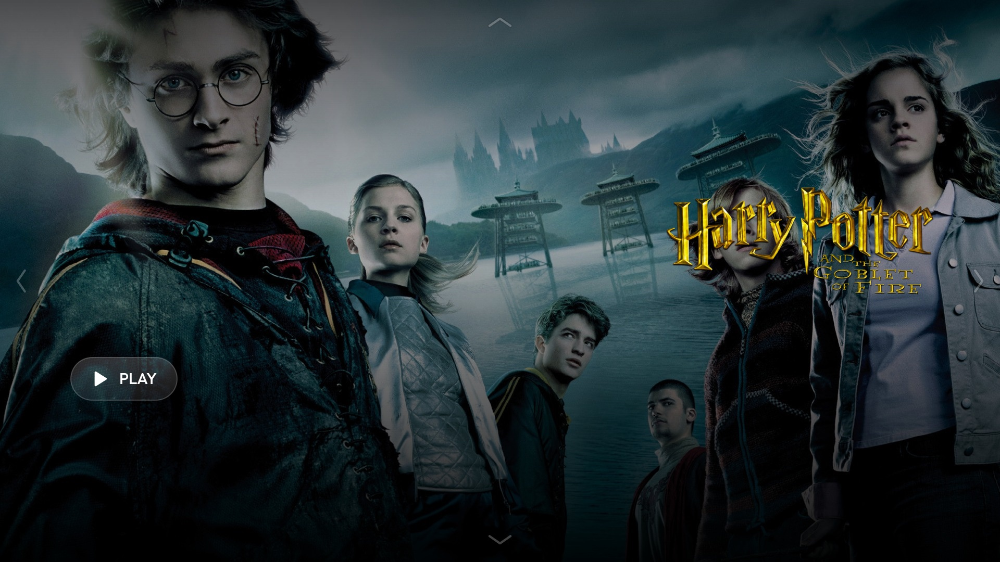 | 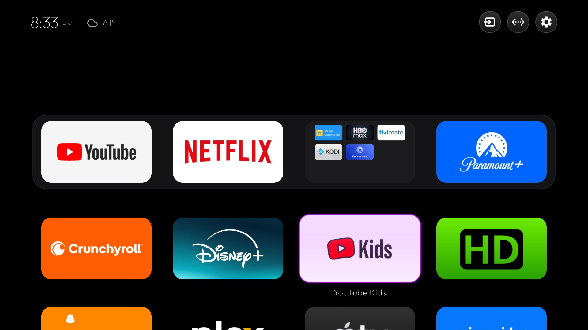 |
|---|---|

Group apps into folders. A folder in the dock turns into a small dial above it: Left and Right spin it,
and the background follows whichever app is in the middle.

| 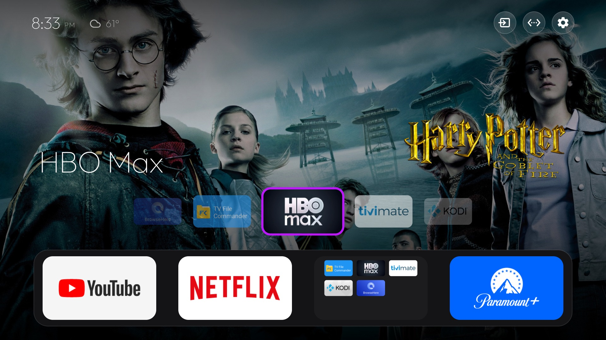 | 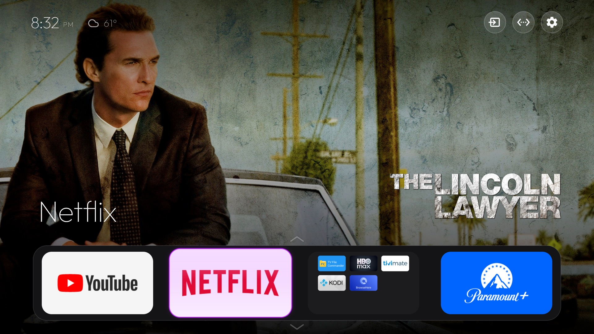 |
|---|---|

The top bar has the clock, the date and the weather, plus menus for your inputs, the network and
settings. Don't want a bar? Switch to the minimal one: a small clock and the weather on the left, three
round buttons on the right, nothing else over your picture.

The Inputs menu lists your HDMI ports and what's plugged into each, by name, even behind a switch.

| 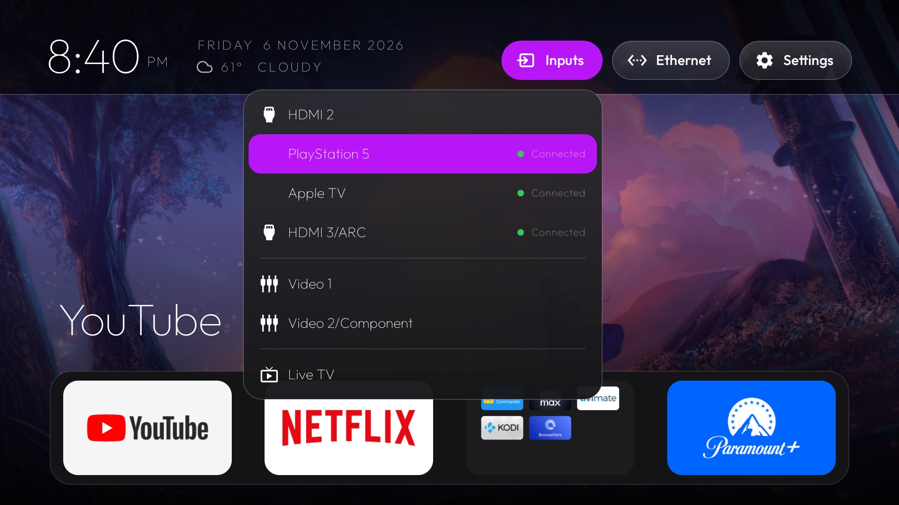 | 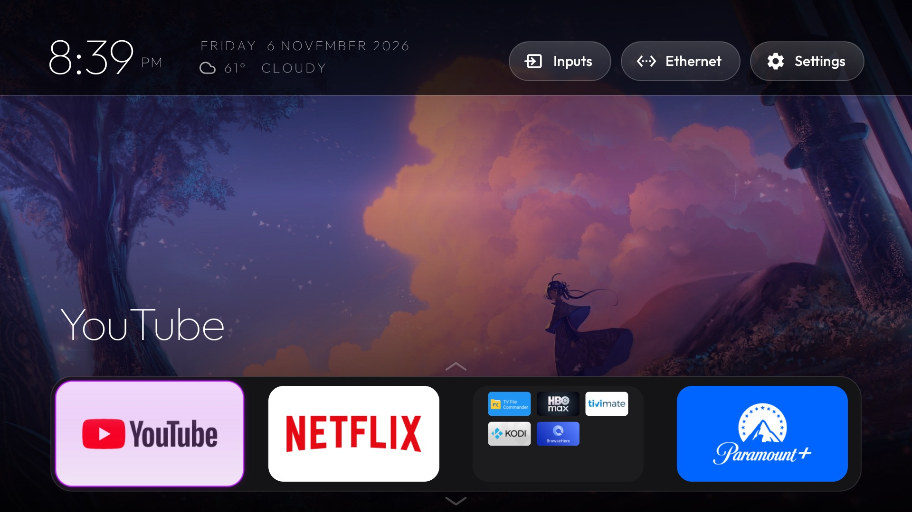 |
|---|---|

### Where the pictures come from

Out of the box it reads the cards your apps already publish (Netflix, Prime Video, Apple TV, Jellyfin and
others) and finds clean artwork for each title. You choose the order it looks: Nuvio, Stremio, TMDB or the
app's own picture. Plex, YouTube (through SmartTube) and an HDHomeRun tuner each get their own pictures too.

You can also use your own wallpapers: photos or videos sent from your phone, pictures from Wallhaven, or
videos from Pexels. Show them only where an app has no picture, or instead of everything.

Leave Home alone for a minute and it turns into a slideshow of all of it.

## Cleaning up your TV

Most TVs come with apps you never asked for that run in the background, fill the home screen and slow
everything down. Vibe Launcher can turn them off, from the TV, the same way a computer with ADB would.

Open **Settings → Advanced** and it tells you what to switch on, one step at a time, until it's connected to
the TV's own ADB. On TVs that only have Wireless debugging, that includes the one-time pairing with your
phone. It turns debugging back off when you leave Settings. Then:

- **Clean-up lists**: tested lists from the [Clean Your TV](https://github.com/Gathin23/cleanyourtv)
  community, with your TV's brand and model at the top. Pick one, untick anything you want to keep, and
  turn the rest off.
- **Apps you can turn off**: every app on the TV, on or off with OK.
- **Turn all back on**: undoes everything Vibe Launcher turned off, and nothing else.
- **Default launcher**: makes Vibe Launcher the real Home, or puts your TV's own back.

Parts the TV needs (Android itself, the Play Store, the remote, Wi-Fi, the inputs) are protected and
can't be turned off from here. A turned-off app is still installed, and one press brings it back.

| 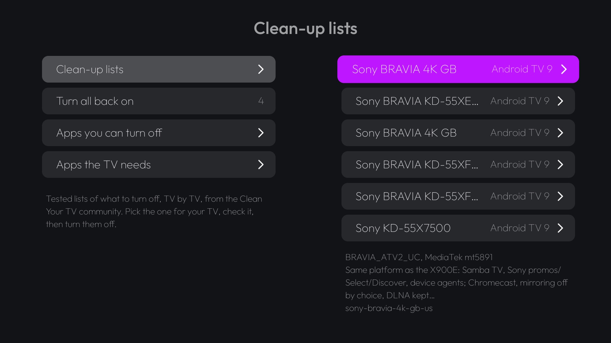 | 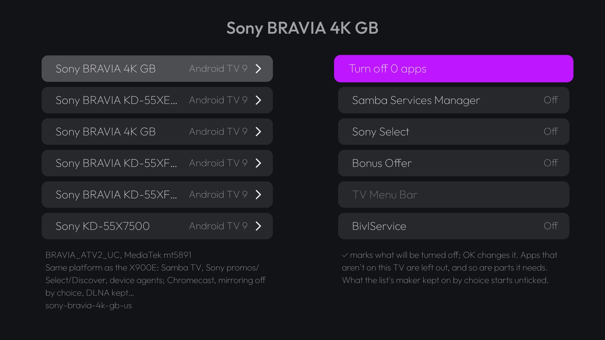 |
|---|---|

## Settings

Everything is in Vibe Launcher's own settings: appearance, the top bar, backdrops and wallpapers, weather,
API keys, and the Advanced tab for the cleanup. Anything long to type, like an API key or a picture,
comes from your phone: scan the QR code on screen and do it there.

| 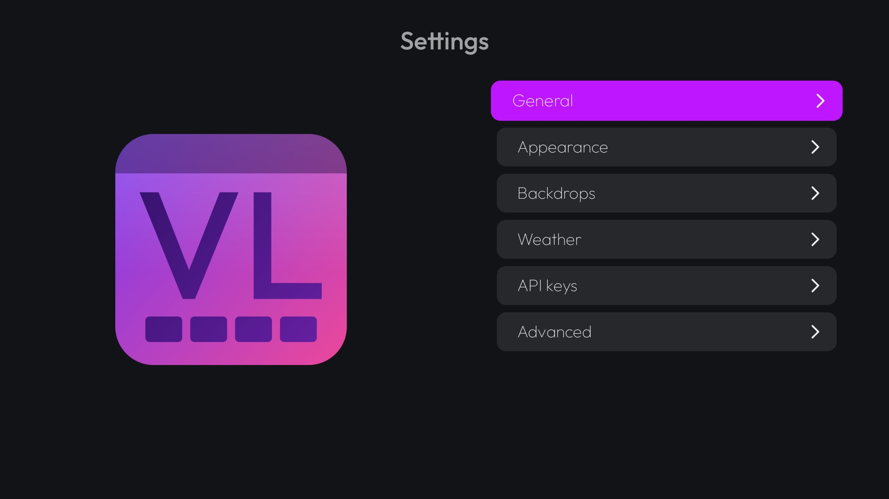 | 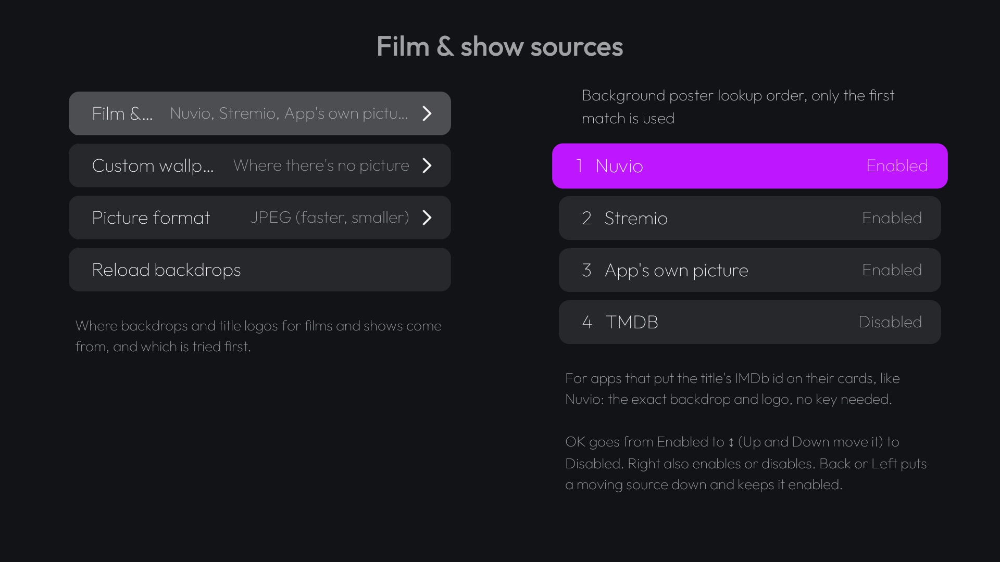 |
|---|---|

Pick the highlight color for whatever's focused on a color wheel, with a preview on a white tile.

| 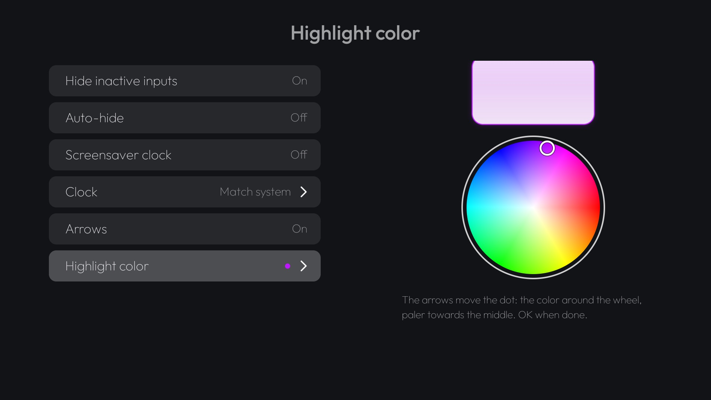 | 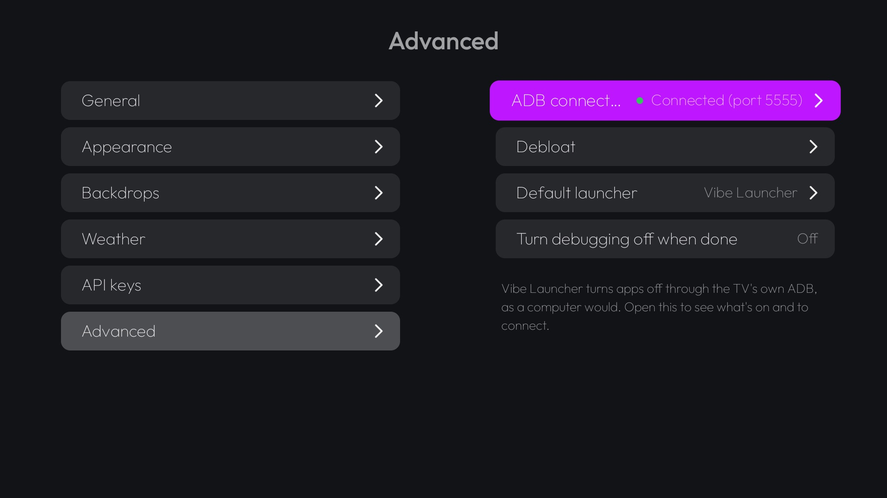 |
|---|---|

Also in there:

- **Backup and restore**: save your setup to your phone and bring it back, or move it to another TV. It
  holds your tiles, folders, custom pictures, settings and keys. What you turned off stays with each TV.
- **Updates**: it checks for new versions, shows what changed, and installs with one confirmation.
- **50 languages**, following your TV or picked by hand.

## Privacy

Nothing is collected and nothing is sent to me. It goes online only for artwork, the weather, the
wallpapers you browse, the clean-up lists and its own updates. Your keys stay on the TV. The details are
in the [privacy policy](vibe-launcher/docs/PRIVACY.md).

## Tested on

| Device | Android |
|---|---|
| Sony Bravia XBR-940E | 9 |
| Sony Bravia 900F | 9 |
| NVIDIA Shield TV (2017) | 11 |
| onn 4K Streaming Device (Google TV) | 14 |

It should work on any Android TV or Google TV with Android 8.0 or newer.

## Building it

The source, how to build it and how the backdrops work are in [`vibe-launcher/`](vibe-launcher/README.md).
The only script in this repo builds the app and installs it on a TV for development. There are no
debloat scripts: all of that lives in the app. Corrections to the machine-made translations are welcome.

## Licence

MIT, see [`LICENSE`](LICENSE). The Outfit typeface is under the SIL Open Font License (`vibe-launcher/FONT-LICENSE-OFL.txt`). The weather
icons are from [Feather](https://feathericons.com) (MIT). Wireless debugging's SPAKE2 (`Spake2.java`) is a
Java port of BoringSSL's `spake25519.cc` (Copyright 2016 The BoringSSL Authors, Apache License 2.0:
`vibe-launcher/LICENSE-APACHE-2.0.txt`). Backdrops use the TMDB API but aren't endorsed or certified by
TMDB. Weather by [Open-Meteo](https://open-meteo.com).
